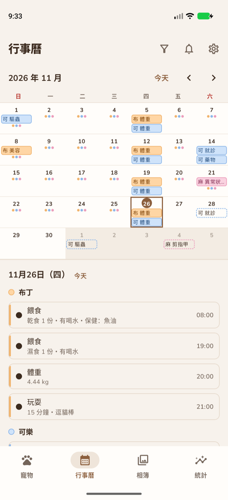
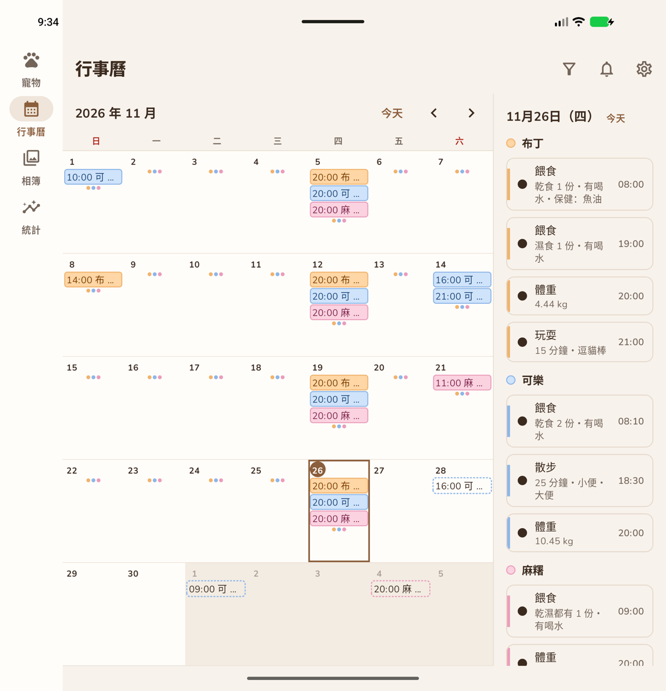
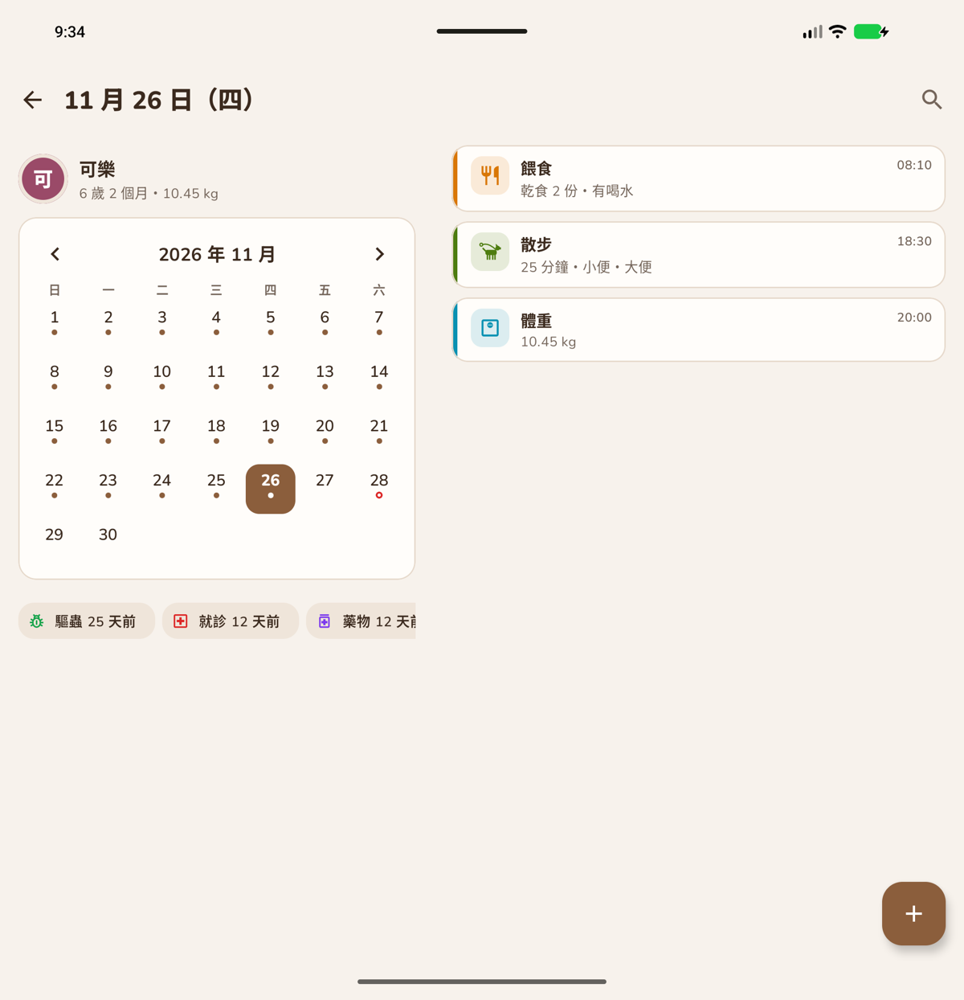
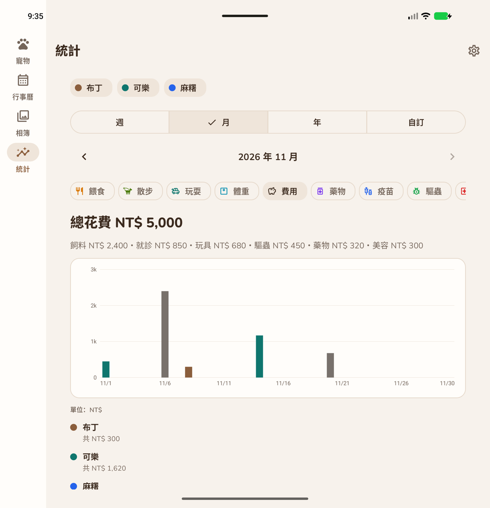

# 🐾 PetDiary 寵物日記

一款讓全家人一起記錄寵物日常的 Android App。餵食、散步、看醫生、疫苗、驅蟲、體重、花費……都能快速記下來，並在該做下一次的時候提醒你。

> 版本：v0.14.1（開發中，以 APK 方式在 [GitHub Releases](https://github.com/ZYLiNN/PetDiary/releases) 發布）｜支援 Android 8.0 以上

## 🎬 展示影片

| 一般手機 | 折疊手機 |
|---|---|
| [▶️ 觀看影片](https://drive.google.com/file/d/1MdJ-RYlIYNVrWQnUTkTbSj7jZ4hEVmN1/view) | [▶️ 觀看影片](https://drive.google.com/file/d/1GY5BNaqOol5cb-rrCWfnLj_b54tLF9xx/view) |

## 📱 畫面截圖

| 行事曆（折起） | 行事曆（攤開） |
|---|---|
|  |  |

| 寵物詳細頁（攤開） | 費用統計（攤開） |
|---|---|
|  |  |

> 截圖使用示範資料，在 Pixel 10 Pro Fold 模擬器上拍攝。

---

## 為什麼做這個 App

- 常常忘記「上次驅蟲、打疫苗、看醫生是什麼時候」。
- 家裡好幾個人一起照顧，容易重複餵食或重複餵藥。
- 市面上的 App 功能太多、太複雜，想要一個**簡單直覺、能少一步就少一步**的工具。

---

## 主要功能

| 功能 | 說明 |
|---|---|
| 📝 多種紀錄 | 餵食（乾食／濕食／零食、保健食品）、散步、玩耍、體重、藥物、疫苗／驅蟲、就診、美容、異常狀況、購物；每筆可附最多 10 張照片或 PDF |
| 📅 行事曆 | 月曆依寵物代表色標示紀錄與提醒，點日期可看當天清單、直接新增紀錄 |
| 🔔 提醒 | 記錄疫苗、驅蟲時可順便設定下次日期；支援單次／每天／每 N 天／每月／每年；通知上按「完成」就自動留下紀錄 |
| 🔍 搜尋 | 關鍵字搜尋所有紀錄，可依寵物、類型、日期篩選 |
| 📈 統計 | 可依週／月／年／自訂期間查看每隻寵物的餵食份量、散步與玩耍時間、體重變化，以及每月花了多少錢（依飼料、就診、玩具等分類）；看醫生、疫苗、驅蟲等也能統計次數 |
| 🖼 相簿 | 集中瀏覽所有紀錄的照片，可左右滑動、兩指縮放 |
| 👨‍👩‍👧 家庭共編 | 用 QR Code 或 https 邀請連結（一次性、有期限）加入家庭群組，每筆紀錄顯示是誰記錄的 |
| ☁️ 雲端同步 | 預設匿名登入、免註冊；可綁定 Google 帳號備份與換機；可一鍵刪除雲端帳號與資料 |
| 🗑 其他 | 7 天垃圾桶可復原、CSV 匯出、淺色／深色主題 |

---

## 技術架構

| 類別 | 使用技術 |
|---|---|
| 語言 / UI | Kotlin、Jetpack Compose（Material 3）、Navigation 3 |
| 本機資料 | Room（離線優先） |
| 雲端 | Firebase Authentication、Cloud Firestore、Cloud Storage、Firebase Hosting |
| 帳號 | 匿名登入 + Credential Manager 綁定 Google 帳號 |
| 背景工作 | AlarmManager（提醒通知）、WorkManager（定期清理垃圾桶） |
| 圖片 | Coil（載入大頭照、相簿、附件縮圖） |
| QR Code | ZXing（產生邀請 QR Code）、Google Code Scanner（掃描） |
| 圖表 | 自行以 Compose Canvas 繪製 |

### 設計重點

- **離線優先（offline-first）**：所有資料先存在手機的 Room 資料庫，沒有網路也能正常使用；開啟雲端同步後再同步到 Firestore。
- **從第一天就能同步的資料結構**：UUID 主鍵、`updatedAt` 更新時間、軟刪除旗標（刪除只做標記）；同時修改時以雲端伺服器時間為準。
- **資安**：Firestore／Storage 安全規則以「家庭群組成員」身分控管讀寫，並以 Firebase Emulator 撰寫規則測試，確保資料不會被其他使用者讀到。資料庫不儲存使用者 Email。
- **折疊螢幕支援**：依螢幕寬度＋高度（Window Size Class）調整排版。折起時導覽列在下方，攤開時移到左側，畫面夠寬時分成左右兩欄；折疊／攤開時輸入中的資料不會遺失。已針對 OPPO Find N6、Samsung Galaxy Z Fold 8 調整。

### 架構圖

```
           手機 App 畫面（Jetpack Compose）
                       │
                   ViewModel
            （整理畫面要顯示的資料）
                       │
                  Repository
             （統一存取資料的窗口）
                       │
          ┌────────────┴────────────┐
          │                         │
          ▼                         ▼
   Room（手機本機資料庫）      AlarmManager
   存資料，離線也能用          排定提醒通知
          ⇅
   SyncEngine（有網路時在背景同步）
          ⇅
   Cloud Firestore / Storage
   （雲端：文字資料／照片）
```

### 專案結構

App 的程式碼依「負責的工作」分成五個資料夾（都在 `app/src/main/java/com/zylinn/petdiary/` 底下）：

| 資料夾 | 負責什麼 | 舉例 |
|---|---|---|
| `ui/` | **畫面**：使用者看得到、點得到的東西 | 寵物列表、行事曆、新增紀錄的表單、統計圖表 |
| `domain/` | **計算規則**：不管畫面長怎樣都一樣的邏輯 | 從生日算出「3 歲 2 個月」、算出下次提醒日期、加總每月花費 |
| `data/` | **存資料**：把紀錄存進手機、讀出來 | 新增一筆餵食紀錄、刪除後放進垃圾桶、匯出 CSV |
| `sync/` | **雲端**：把手機資料和雲端同步 | 上傳新紀錄、家人新增的紀錄同步下來、加入家庭群組 |
| `reminder/` | **提醒通知**：時間到了跳通知 | 「該幫雷利點眼藥了」 |

專案根目錄的其他資料夾：

| 資料夾 | 內容 |
|---|---|
| `firebase/` | 雲端的安全規則（誰可以讀寫哪些資料）與規則測試、邀請連結網頁 |
| `docs/` | 需求計畫、設計規範、測試清單、每一輪的開發紀錄 |

---

## 測試

| 類型 | 數量 | 指令 |
|---|---|---|
| 單元測試（JVM） | 164 | `./gradlew testDebugUnitTest` |
| UI／整合測試（模擬器） | 269 | `./gradlew connectedDebugAndroidTest` |
| Firebase 安全規則測試 | 58 | `cd firebase && npm install && npm test` |

自動測試在 `Pixel_10_Pro_Fold` 模擬器上執行，涵蓋折起與攤開兩種狀態。

---

## 自行建置

需求：Android Studio（使用內建 JBR）、Android SDK 37、minSdk 26。

```bash
git clone https://github.com/ZYLiNN/PetDiary.git
cd PetDiary
./gradlew assembleDebug
```

- `google-services.json` **不包含在 repo 裡**。沒有這個檔案也能編譯和使用，只是沒有雲端同步與家庭共編功能。
- 如果要啟用雲端功能，請建立自己的 Firebase 專案（啟用匿名登入、Google 登入、Firestore、Storage），把 `google-services.json` 放到 `app/` 資料夾，並用 `firebase/` 裡的規則部署。

---

## 開發方式：AI 輔助開發

這個專案以 [Claude Code](https://claude.com/claude-code) 作為開發夥伴，練習「需求 → 規格 → 分階段實作 → 自動測試 → 實機驗收」的流程：

1. 先和 AI 一起確認需求規格（[`docs/PLAN.md`](docs/PLAN.md)）、UI 設計系統（[`docs/design/MASTER.md`](docs/design/MASTER.md)）和驗收清單（[`docs/TEST_CHECKLIST.md`](docs/TEST_CHECKLIST.md)）。
2. 依 P0～P14 分階段開發，每個階段拆成資料層、UI、測試等小任務，編譯並跑完測試、在模擬器截圖驗收後才進下一階段。
3. 每一輪都留下開發紀錄（[`docs/loop-logs/`](docs/loop-logs/)），AI 自行做的判斷記錄在 [`docs/DECISIONS_FOR_REVIEW.md`](docs/DECISIONS_FOR_REVIEW.md)，由我確認後才定案。
4. 每次修改都以 Conventional Commits 格式提交，每個版本產出 APK 讓我在實機上測試。
