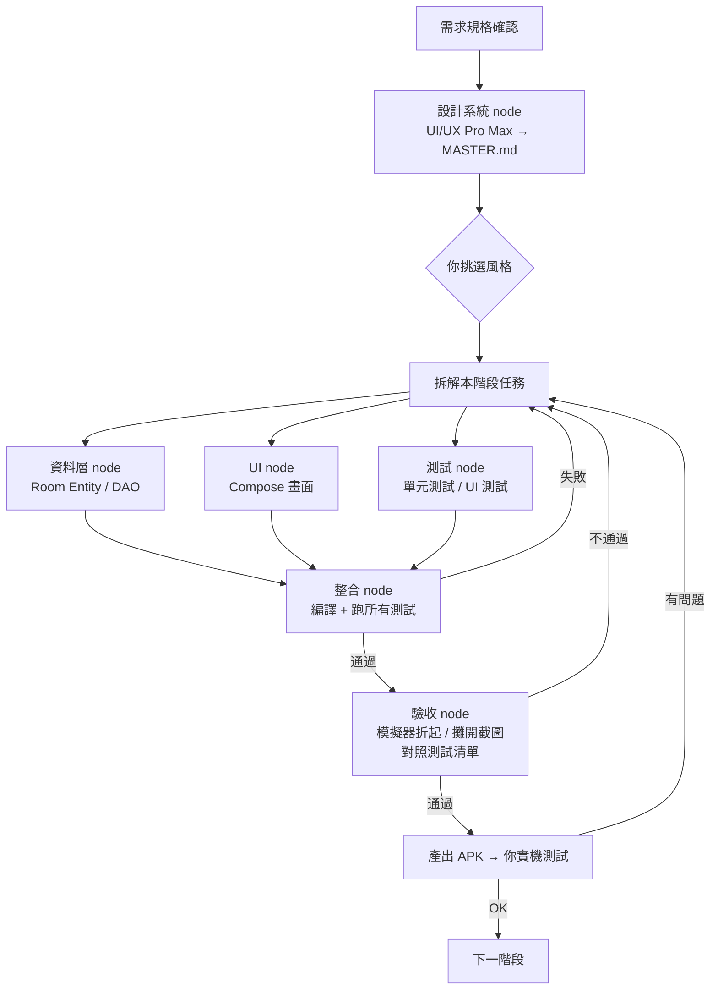

# PetDiary 寵物日誌 — 計劃書 v0.2

> 狀態：功能需求已確認（v0.2，2026-10-18）
> 變更紀錄：v0.1 初稿 → v0.2 確認第 10 節的 8 個決策
> 標記說明：✅ 已確認　💡 建議或設計細節

---

## 0. 已確定的技術方向

| 項目 | 決定 |
|---|---|
| 語言 / UI | Kotlin + Jetpack Compose（Material 3） |
| 本機資料 | Room 資料庫（離線也能用） |
| 雲端 | Firebase：Firestore（文字資料）、Cloud Storage（照片）、Auth（帳號） |
| 帳號 | 一開始匿名登入，可選擇綁定 Google 帳號來備份和換機 |
| 共編 | 用 QR Code 加入家庭群組（邀請碼有期限、只能用一次） |
| 折疊螢幕 | 支援 OPPO Find N6、Samsung Fold 8 寬折疊；排版同時依螢幕寬度和高度調整 |
| 發布 | APK / GitHub Releases |

---

## 1. 整體導覽結構

### ✅ 你的需求
畫面下方有分頁可以切換：紀錄主頁 / 統計 / 設定，另外可能再加一個排程通知頁。

### ✅ 確定：4 個分頁
```
[ 🐾 寵物 ] [ 🔔 提醒 ] [ 📈 統計 ] [ ⚙️ 設定 ]
```
- **提醒建議獨立成一頁**：提醒是每天都會用到的功能，放在設定裡太深，不好找。另外，記錄驅蟲、疫苗時可以順便設定下次提醒，所以獨立一頁比較順手。
- **不建議用左側抽屜選單**：抽屜藏在畫面外面，使用者不容易發現。Material 3 的設計指引也比較推薦用分頁列。目前只有 4 個主要頁面，用分頁列就夠了。
- **折疊螢幕的處理**：折起來時，分頁列在畫面**下方**；攤開時自動移到畫面**左側**，變成側邊導覽列。這會用 `NavigationSuiteScaffold` 元件自動切換。

> 📝 技術補充：Compose 已經不用 Fragment 了。每個分頁是一個「畫面目的地」，由 Navigation 元件負責切換，概念上和以前的 Fragment 切換一樣，但寫起來更簡單。

---

## 2. 寵物主頁（方格列表）

### ✅ 你的需求
- 用方格排列所有寵物，最後一格永遠是「＋」，點下去跳出新增寵物的 Dialog
- 方格上方是圓形大頭照，右上角依寵物類型顯示對應的剪影（貓、狗……）
- 新增時，必填：寵物類型、名稱、年齡；選填：照片

### 💡 建議
1. ✅ **用「生日」取代「年齡」**：年齡會隨時間過期，存生日的話，年齡每天自動計算。
   - 如果是領養的、不知道確切生日，可以選「大約 X 歲」，系統會換算成估計的生日，並標示為「約」。
2. **寵物類型**：貓、狗、兔、鼠類、鳥、爬蟲、魚、其他。選「其他」時可以自己輸入名稱，剪影顯示通用的腳掌圖示。
3. ✅ **選填欄位**：照片、性別、是否結紮、品種、晶片號碼、備註。
   - 晶片號碼在走失或看醫生時很常用到。
4. **方格欄數依螢幕寬度調整**：折起來時 2 欄，攤開時 3～4 欄。
5. **方格上可以順便顯示一行摘要**，例如「3 歲 2 個月」或「今天已餵食 ✓」。
6. **長按方格**可以編輯或刪除寵物。刪除前會再確認一次，避免手滑刪掉。

---

## 3. 寵物詳細頁（每日紀錄）

### ✅ 你的需求
- 上方有下拉式月曆，有紀錄的日期會標上綠點
- 預設顯示今天，紀錄以卡片列表往下排，最後一張是「＋」卡片，點下去跳出 Dialog 新增紀錄
- 不同紀錄類型的卡片用不同顏色區分

### 💡 建議
1. **在月曆下方加「上次紀錄」摘要列（推薦）**
   ```
   上次驅蟲：45 天前（9/3）　上次疫苗：120 天前　上次看診：12 天前
   ```
   這可以直接解決你提到的「常常忘記上次是什麼時候」，連搜尋都不用。
2. **顏色加圖示**：每種紀錄類型都有自己的**顏色＋圖示**。只靠顏色的話，色盲使用者會分不出來，而且有圖示也更容易一眼辨識。
3. **折疊螢幕攤開時**：左邊是月曆，右邊是當天的紀錄列表，可以同時看到。
4. ✅ **新增紀錄用右下角浮動按鈕（FAB）**，永遠看得到，不用捲到最下面。

### 紀錄類型與欄位

| 類型 | 你提出的欄位 | 💡 建議補充的欄位 |
|---|---|---|
| 🍚 餵食 | 主食份數、有沒有喝水（勾選）、保健食品（下拉選單，種類可以自訂） | 時間（一天可能餵好幾次）、備註 |
| 💊 藥物 | 藥物資訊、費用 | 劑量、醫院 / 購買地點、**下次用藥日期** |
| 💉 疫苗 | 疫苗資訊、費用 | 醫院、**下次施打日期** |
| 🐛 驅蟲 | 驅蟲資訊、費用 | 內驅或外驅、**下次驅蟲日期** |

**💡 有「下次日期」的類型，存檔時可以順便建立提醒**（可以勾選要或不要），和提醒頁直接連動。

### ✅ 確認新增的紀錄類型（日記不做）
| 類型 | 用途 |
|---|---|
| ⚖️ **體重** | 強烈建議。體重是健康最重要的指標，也最適合用折線圖統計 |
| 🏥 就診紀錄 | 看醫生的原因、診斷、醫院、費用、下次回診日期 |
| 🛁 美容 | 洗澡、剪指甲、美容、費用 |
| ⚠️ 異常狀況 | 嘔吐、拉肚子、精神不好，看醫生時可以拿給醫生參考 |

---

## 4. 搜尋功能（你強烈希望要有）

### ✅ 你的需求
輸入「疫苗」、「驅蟲」等關鍵字，就會列出「日期＋紀錄卡片」；類型和內容都要能搜尋。

### 💡 設計
- **搜尋範圍**：紀錄類型、藥名、醫院、備註等所有文字欄位。
- **篩選條件**：寵物（可以多選）、紀錄類型（快速選擇的標籤按鈕）、日期範圍。
- **結果顯示**：依日期由新到舊排列，用和詳細頁一樣的彩色卡片；點卡片可以跳到那一天。
- **技術做法**：用 Room 的全文搜尋功能（FTS），資料再多也能快速找到，而且不需要網路。
- ✅ 搜尋入口兩個都做：寵物詳細頁右上角（只搜尋這隻寵物）、寵物主頁右上角（搜尋所有寵物，可以再篩選）

---

## 5. 統計頁

### ✅ 你的需求
- 預設以「週」為單位，每隻寵物用不同顏色的線
- 篩選條件：寵物（可以多選）、時間區間（週 / 月 / 年 / 自訂，單選）、統計項目（餵食、藥物、疫苗、驅蟲、費用，單選）

### 💡 需要注意的地方
疫苗、驅蟲這類紀錄很久才一次，畫成折線圖的話，幾乎整條都是 0，看不出什麼。建議**依統計項目使用不同的圖表**：

| 統計項目 | 建議的圖表 | 呈現內容 |
|---|---|---|
| 餵食 | 折線圖 | 每天主食的份數 |
| 費用 | 長條圖（依寵物分色堆疊）＋ 總金額 | 每週 / 每月的花費 |
| 體重（如果有加） | 折線圖 | 體重變化 |
| 藥物 / 疫苗 / 驅蟲 | 時間軸或次數長條圖 | 什麼時候做過、做過幾次 |

- 圖表用 **Vico** 這個套件繪製。它是專門給 Compose 用的圖表工具。
- ✅ 確認依統計項目使用不同的圖表。
- 統計項目（單選）：餵食、體重、費用、藥物、疫苗、驅蟲、就診、美容、異常狀況

---

## 6. 提醒頁

### 💡 設計
- **提醒類型**：餵藥、疫苗、驅蟲、點藥（點眼藥、耳藥），也可以自訂。
- **重複方式**：只提醒一次 / 每天 / 每 N 天 / 每月 / 每年。
- **列表顯示**：依「即將到期」排序，已經過期的標成紅色。
- **按通知可以直接打開紀錄 Dialog**，例如「餵藥完成 ✓」，按一下就記錄好了。
- **技術做法**：用手機本機的鬧鐘機制，不需要伺服器，也不用錢。
- **⚠️ OPPO（ColorOS）和 Samsung（One UI）比較會主動關閉背景程式**，可能讓提醒沒跳出來。App 會引導使用者把 PetDiary 加入電池最佳化的白名單。

---

## 7. 設定頁

| 項目 | 內容 |
|---|---|
| 帳號與備份 | 綁定 Google 帳號、目前的同步狀態 |
| 家庭群組 | 產生邀請 QR Code、掃描加入、成員列表、移除成員 |
| 外觀 | 淺色 / 深色 / 跟隨系統；主題色（💡 也可以支援 Android 的「動態取色」，配色跟著手機桌布變） |
| 自訂項目 | 管理保健食品清單、自訂紀錄類型 |
| 資料 | 匯出資料（CSV 或 PDF，看醫生時可以拿給醫生看） |
| 帳號管理 | 刪除帳號和所有資料 |
| 關於 | 版本、隱私權政策 |

💡 **家庭共編時，每張紀錄卡片都顯示「是誰記錄的」**，例如「媽媽 記錄」，避免重複餵食或重複餵藥。

---

## 8. 開發階段（MVP 先做，之後逐步擴充）

> 💡 建議先做好**本機版**，確認功能和畫面都滿意後，再接 Firebase 雲端。
> 不過資料結構**從第一天就會設計成可以同步的格式**（例如每筆資料用全域唯一的 ID、有更新時間、刪除時只做標記），之後接雲端時不用重寫。

| 階段 | 內容 | 完成時給你的東西 |
|---|---|---|
| P0 | 專案骨架、主題、4 個分頁導覽、折疊螢幕排版 | 可以切換分頁的空殼 App |
| P1 | 寵物新增 / 編輯 / 刪除、方格主頁、剪影圖示 | APK v0.1 |
| P2 | 寵物詳細頁、月曆、紀錄卡片、新增紀錄 Dialog | APK v0.2 |
| P3 | 搜尋、「上次紀錄」摘要列 | APK v0.3 |
| P4 | 提醒頁、本機通知、和紀錄連動 | APK v0.4 |
| P5 | 統計圖表 | APK v0.5 |
| P6 | 設定頁（主題、自訂項目、匯出） | APK v0.6（本機版完成） |
| P7 | Firebase：匿名登入、Firestore 同步、安全規則和測試 | APK v0.7 |
| P8 | 照片雲端同步、QR Code 家庭群組 | APK v0.8 |
| P9 | 綁定 Google 帳號、刪除帳號、App Check | APK v1.0 |

---

## 9. Graph Engineering 開發流程（每個階段的 node 圖）



---

## 10. ✅ 已確認的決策（2026-10-18）

1. 分頁：4 個（寵物 / 提醒 / 統計 / 設定）
2. 存生日，不知道生日時可以填「大約幾歲」
3. 寵物選填欄位：照片、性別、結紮、品種、晶片號碼、備註
4. 新增紀錄：右下角浮動按鈕（FAB）
5. 紀錄類型：餵食、藥物、疫苗、驅蟲 ＋ 體重、就診紀錄、美容、異常狀況（不做日記）
6. 搜尋：寵物詳細頁和主頁兩個入口都做
7. 統計：依項目使用不同的圖表
8. 開發順序：先做本機版（P1–P6），再接雲端（P7–P9）

## 11. 💡 簡化提案（待決定，預覽見 `docs/design/style-preview.html`）

| # | 提案 | 省下什麼 |
|---|---|---|
| S1 | 新增紀錄改成從下方滑出的面板：先點類型圖示，再填欄位；日期預設為目前選的那天、時間預設為現在 | 少一個下拉選單，單手就能操作 |
| S2 | 「一鍵記錄」：面板最下面顯示「餵食・同上次」，按一下直接存 | 每天重複的餵食只要 2 下 |
| S3 | 一次記錄多隻寵物：面板上方的寵物可以複選 | 同時餵兩隻貓不用記兩次 |
| S4 | 主頁上方加「今天待辦」，直接勾選完成，勾完自動建立紀錄 | 不用切到提醒頁，也不用另外記錄 |
| S5 | 詳細頁的月曆平常只顯示一週（有圓點），需要時再展開成整個月 | 畫面空間留給紀錄卡片 |
| S6 | 刪除不跳確認視窗，改成「已刪除・復原」提示 | 少按一次確認 |
| S7 | 保健食品在餵食表單裡就能直接新增，不用先去設定頁 | 少跳一個頁面 |
| S8 | 主頁和詳細頁共用同一個搜尋畫面，只差在是否預設篩選寵物 | 學一次就會 |
| S9 | 設定頁的「Google 帳號」和「家庭群組」合併成「帳號與家人」 | 設定項目少一個 |
| S10 | 新增寵物時只顯示必填欄位，選填欄位收在「更多資料」裡 | 第一次新增更快 |
| S11 | ✅ 藥物 / 疫苗 / 驅蟲 / 就診共用同一個表單版型（名稱、費用、醫院、下次日期、**附件**） | 學一次就會，開發也比較快 |
| S12 | 卡片點一下就是編輯，左滑刪除 | 不用長按或開選單 |

## 12. ✅ 新增功能（2026-10-18 確認）

### 附件（照片 / PDF）
- 適用類型：藥物、疫苗、驅蟲、就診（💡 建議也加在「異常狀況」，例如拍下嘔吐物或傷口給醫生看）
- 來源：拍照、相簿、檔案（PDF）
- 一筆紀錄可以有多個附件；照片自動壓縮
- 檔案會複製到 App 自己的儲存空間，之後跟著雲端同步（P8）
- ❓ 單一檔案大小上限待定

### 垃圾桶（保留 7 天）
- 刪除寵物 → 連同牠的紀錄、附件、提醒一起移到垃圾桶
- 7 天內可以還原，所有資料原封不動回來；超過 7 天自動永久刪除
- 入口：設定頁 →「垃圾桶」
- 技術上很自然：資料本來就是「標記刪除」（軟刪除），垃圾桶只是把這些標記的資料列出來，再加一個每天自動清除的排程
- ❓ 單筆紀錄刪除時是否也進垃圾桶，待定

## 13. 下一步

- [x] 設計階段：產出 3 套風格預覽（`docs/design/style-preview.html`）→ 等你挑選
- [x] 撰寫測試清單草稿（`docs/TEST_CHECKLIST.md`）→ 等你確認
- [x] 建立 git 版本控制
- [ ] 確認簡化提案 S1～S12
- [ ] 開始 P0
