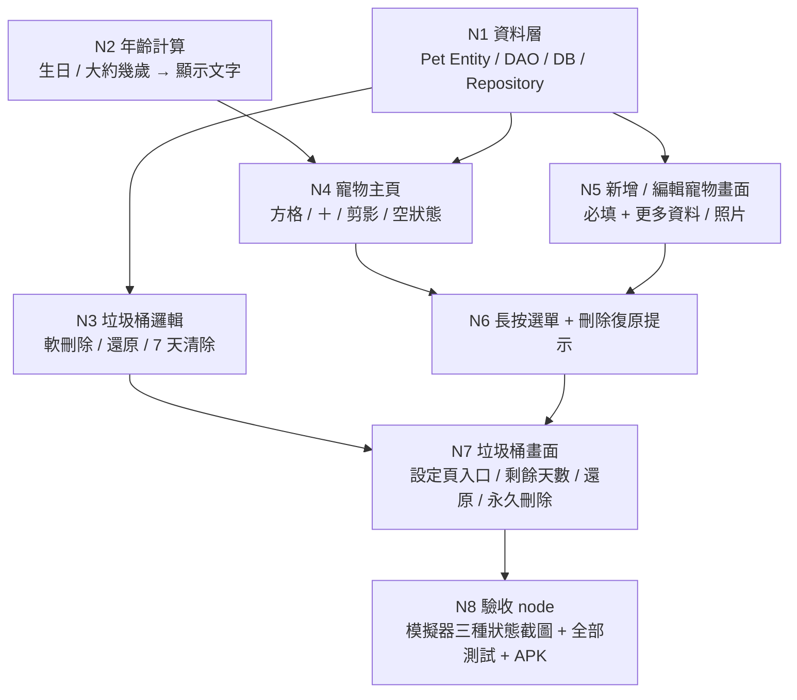

# P1 寵物管理 — 任務拆解（Graph）

> 驗收：`docs/TEST_CHECKLIST.md` 的 C-01～C-10、P1-01～P1-13、T-01～T-09（寵物部分；紀錄、提醒相關的 T 項目在 P2 / P4 補驗）
> loop 每一輪挑「依賴都已完成、狀態為 todo」的第一個 node 來做。

## 技術決定（P1 範圍）
- 資料庫：Room。主鍵 UUID 字串、`createdAt` / `updatedAt` / `deletedAt`（軟刪除，`deletedAt != null` 代表在垃圾桶）
- 依賴注入：手寫 `AppContainer`（不用 Hilt，保持簡單）
- 頁面導覽：Navigation 3（主頁 → 新增 / 編輯寵物）
- 圖片：Photo Picker（不需要權限）＋ 相機（`TakePicture` + FileProvider）；Coil 顯示圓形大頭貼
- 剪影圖示：Lucide（ISC 授權）轉成 Android VectorDrawable
- 垃圾桶自動清除：App 啟動時 ＋ WorkManager 每日一次
- 時間計算用 `java.time`，並注入 `Clock`，方便測試「第 6 天 23 小時」這類情境

## Node 圖

## Node 清單

| Node | 內容 | 依賴 | 對應測試 | 狀態 |
|---|---|---|---|---|
| N1 | Room：`PetEntity`、`PetDao`、`PetDiaryDatabase`、`PetRepository`、`AppContainer` | — | P1-06、P1-11 | ✅ done |
| N2 | 年齡計算與顯示（含「約」、跨月、閏年） | — | P1-04、P1-05 | ✅ done |
| N3 | 垃圾桶邏輯：軟刪除、還原、7 天清除（含照片檔）、啟動時清除 + WorkManager | N1 | T-01、T-05、T-06、T-07 | ✅ done |
| N4 | 寵物主頁：自適應欄數方格、大頭貼、剪影、＋方格、空狀態引導 | N1、N2 | P1-01、P1-08、P1-09、P1-12 | todo |
| N5 | 新增 / 編輯寵物：必填驗證、更多資料收合、照片（相簿 / 相機） | N1 | P1-02、P1-03、P1-06、P1-07、P1-13 | todo |
| N6 | 長按方格 → 編輯 / 刪除；刪除後 5 秒「復原」提示，之後進垃圾桶 | N4、N5、N3 | P1-10 | todo |
| N7 | 垃圾桶畫面：設定頁入口、剩餘天數、還原、永久刪除（才確認） | N3、N6 | T-03、T-04、T-08、P6-06 | todo |
| N8 | 驗收：全部自動測試、📱📖↔️ 截圖、深色、字體 200%、產出 debug APK | N1～N7 | C-01～C-10 | todo |

## Loop 規則（摘自 CLAUDE.md）
- 每完成一個 node：測試通過 → commit + push → 更新本表狀態
- 每一輪寫一份 `docs/loop-logs/` 紀錄
- 同一個問題連續 5 輪修不好 → 停下來交給使用者
- 全部 node 完成且 P1 驗收項目都通過 → 停止 loop，回報並附上 APK
