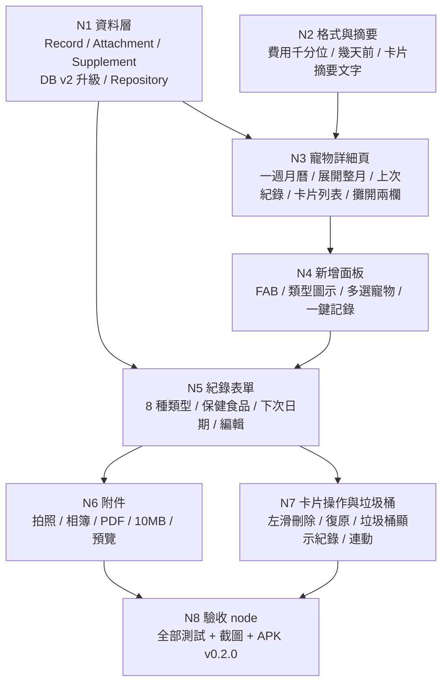

# P2 寵物詳細頁與每日紀錄 — 任務拆解（Graph）

> 驗收：`docs/TEST_CHECKLIST.md` 的 C-01～C-10、P2-01～P2-19，以及垃圾桶 T-00、T-02、T-04、T-04a（紀錄部分）
> loop 每一輪挑「依賴都已完成、狀態為 todo」的第一個 node 來做。

## 技術決定（P2 範圍）
- 資料庫升級 v1 → v2：新增 `records`、`attachments`、`supplements` 三張表，用 Room 的自動升級（AutoMigration），已建立的寵物資料保留
- 一筆紀錄 = 一隻寵物 × 一個時間點。多選寵物時建立多筆**各自獨立**的紀錄（P2-14）
- 紀錄用「共用欄位＋類型專屬欄位」的單一資料表，避免 8 張表：
  - 共用：類型、日期（epoch day）、時間（當天第幾分鐘）、備註、費用（整數元）
  - 餵食：主食份數、喝水、保健食品（id 清單）
  - 醫療（藥物 / 疫苗 / 驅蟲 / 就診）：名稱、劑量或診斷、醫院、下次日期、要不要提醒、驅蟲內外
  - 體重：公斤；美容：項目；異常：症狀
- 寵物進垃圾桶時，紀錄**不另外標記**，而是跟著寵物一起隱藏；寵物永久刪除時，紀錄與附件一併刪除（T-02）
- 單筆紀錄刪除 → 紀錄自己的 `deletedAt`，出現在垃圾桶（T-00）
- 附件存在 `files/attachments/`；照片沿用 `PhotoImporter` 壓縮；PDF 原樣複製；單檔上限 10MB
- 「下次日期」的提醒：P2 先存「要提醒」的勾選，P4 做提醒功能時自動補建（見 D11）
- 月曆自己畫（Material 的 DatePicker 不能加圓點）

## Node 圖

## Node 清單

| Node | 內容 | 依賴 | 對應測試 | 狀態 |
|---|---|---|---|---|
| N1 | Entity / DAO / DB v2 自動升級 / `RecordRepository`（多寵物新增、依日期查詢、有紀錄的日期、各類型最後一次、最後一次餵食）/ 永久刪除連動 | — | P2-12、P2-13、P2-14、T-02 | ✅ done |
| N2 | 費用解析與千分位、「X 天前」、各類型卡片摘要文字 | — | P2-08、P2-03（計算） | ✅ done |
| N3 | 點寵物方格進入詳細頁：標頭、一週月曆＋圓點、展開整月、上次紀錄摘要、卡片列表（顏色＋圖示）、攤開時左右兩欄 | N1、N2 | P2-01、P2-02、P2-02a、P2-03、P2-09、P2-10、P2-11 | ✅ done |
| N4 | FAB → 下方面板（攤開時改對話框）：寵物複選、8 種類型圖示、「餵食・同上次」 | N3 | P2-04、P2-05a、P2-05c、P2-05d、P2-05e、P2-05f | ✅ done |
| N5 | 紀錄表單：8 種類型、日期時間預設、餵食＋保健食品（當場新增）、醫療共用版型＋下次日期＋提醒勾選、體重、美容、異常；編輯既有紀錄 | N1、N4 | P2-05、P2-05b、P2-06、P2-06a、P2-07、P2-07a、P2-13 | ✅ done |
| N6 | 附件：拍照 / 相簿 / PDF、10MB 上限、照片壓縮、多個附件、卡片顯示數量、預覽 / 開啟、刪除單一附件 | N5 | P2-15～P2-19 | ✅ done |
| N7 | 點卡片編輯、左滑刪除＋5 秒復原、垃圾桶列出紀錄並可還原、寵物也在垃圾桶時的處理 | N5 | P2-05g、P2-05h、T-00、T-04、T-04a | ✅ done |
| N8 | 驗收：全部自動測試、📱📖↔️ 截圖、深色、字體 200%、50 筆捲動、APK v0.2.0 | N1～N7 | C-01～C-10 | ✅ done |

## Loop 規則（摘自 CLAUDE.md）
- 每完成一個 node：測試通過 → commit + push → 更新本表狀態 → 寫 loop log
- 需要判斷時依建議執行並記到 `docs/DECISIONS_FOR_REVIEW.md`
- 同一個問題連續 5 輪修不好 → 停下來交給使用者
- P2 全部完成 → 接著拆解 P3
