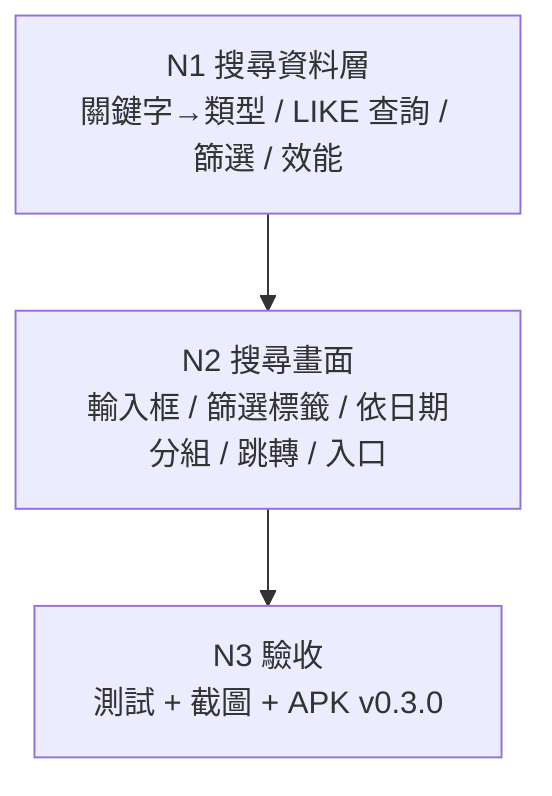

# P3 搜尋 — 任務拆解（Graph）

> 驗收：`docs/TEST_CHECKLIST.md` 的 C-01～C-10、P3-01～P3-08
> 「上次紀錄」摘要列已在 P2 完成。

## 技術決定（P3 範圍）
- **改用 `LIKE` 子字串比對，不用 FTS 全文檢索**（見 D27）：SQLite 的 FTS 斷詞器不會切中文，「蚤不到」裡搜「不到」會找不到；`LIKE '%關鍵字%'` 對中文才正確。1 萬筆內速度足夠（P3-08 有效能測試把關）
- 關鍵字同時比對：
  - **類型名稱**：「疫苗」「驅蟲」「體重」…，也接受常見說法（「看醫生」「看診」→ 就診、「洗澡」→ 美容、「吃飯」→ 餵食…）
  - **內容**：名稱 / 狀況、劑量 / 診斷、醫院、備註、美容項目
  - **保健食品名稱**（例如搜「魚油」找到有吃魚油的餵食紀錄）
- 只搜尋「寵物沒被刪除、紀錄也沒被刪除」的資料
- 搜尋畫面只有一個（S8）：從主頁進入 = 全部寵物；從詳細頁進入 = 預設篩選該寵物（可以取消）
- 點結果 → 跳到那隻寵物的那一天（詳細頁要能指定起始日期）

## Node 圖

## Node 清單

| Node | 內容 | 依賴 | 對應測試 | 狀態 |
|---|---|---|---|---|
| N1 | `SearchQuery`、關鍵字對應類型、動態查詢（寵物 / 類型 / 日期篩選、保健食品名稱）、排除已刪除；1 萬筆效能測試 | — | P3-02、P3-03、P3-06（資料）、P3-08 | ✅ done |
| N2 | 搜尋畫面：輸入框、寵物 / 類型 / 日期區間篩選、結果依日期分組（新到舊、同款卡片＋寵物名）、空結果提示；主頁與詳細頁的搜尋入口；點結果跳到該寵物那一天 | N1 | P3-01、P3-04、P3-05、P3-06、P3-07 | ✅ done |
| N3 | 驗收：全部測試、📱📖 截圖、深色、字體 200%、APK v0.3.0 | N1、N2 | C-01～C-10 | todo |
