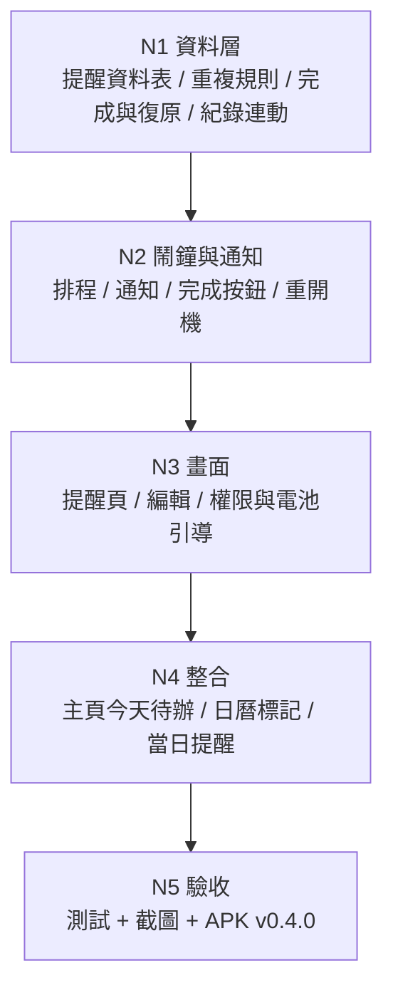

# P4 提醒 — 任務拆解（Graph）

> 驗收：`docs/TEST_CHECKLIST.md` 的 C-01～C-10、P4-01～P4-18（另含散步補充 P2-06b / P2-06d）

## 技術決定
- 一筆提醒 = 「下一次要做的事」。重複的提醒完成後把日期往後移（D37）；一次性的標記完成
- 鬧鐘：AlarmManager，每筆提醒一個鬧鐘；`ReminderSyncer` 監看資料庫，提醒變動就重排、被刪 / 完成就取消；App 啟動、重開機、時間變更都會重排（D38）
- 通知：頻道「寵物提醒」，按鈕「完成」→ 自動建立紀錄；每個時間點只通知一次（D39）
- 通知權限第一次新增提醒才問；OPPO / Samsung 等顯示電池白名單教學（D34、D42）
- 紀錄的「下次日期」＋「到時提醒我」→ 自動連動一筆提醒（D41）
- 日曆在有提醒的日期顯示依類型著色的空心圓圈（D40）；未來日期不能新增紀錄但可新增提醒（D32）

## Node 圖

| Node | 內容 | 對應測試 | 狀態 |
|---|---|---|---|
| N1 | Reminder 實體與 DAO（DB v5）、ReminderSchedule（下次日期、標籤）、ReminderRepository（新增 / 編輯 / 刪除 / 完成 / 復原）、RecordRepository 連動、垃圾桶清除 | P4-04、P4-09、P4-15、P4-16、P4-18 | ✅ done |
| N2 | ReminderScheduler / Notifier / Receivers / Syncer、Manifest 權限、開機重排 | P4-02、P4-03、P4-06 | ✅ done |
| N3 | 提醒頁（已過期 / 今天 / 之後）、編輯畫面、通知權限流程、電池白名單卡片 | P4-01、P4-05、P4-07、P4-08、P4-14、P4-17 | ✅ done |
| N4 | 主頁「今天待辦」、寵物頁日曆標記與當日提醒、未來日「新增提醒」 | P4-10～P4-13 | ✅ done |
| N5 | 全部測試、截圖、APK v0.4.0、實機清單 | C-01～C-10 | ✅ done |
