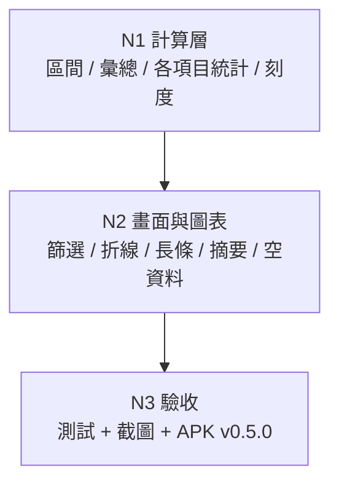

# P5 統計 — 任務拆解（Graph）

> 驗收：`docs/TEST_CHECKLIST.md` 的 C-01～C-10、P5-01～P5-11

## 技術決定
- 圖表自己用 Compose Canvas 繪製（D43）：折線（餵食 / 散步 / 體重）、堆疊長條（費用、各種次數）
- 統計計算是純函式 `StatsCalculator`，用單元測試對照原始紀錄驗證每個數字（P5-06）
- 區間：週（日～六）/ 月 / 年 / 自訂；彙總粒度依長度自動選（D45、D46）
- 寵物可複選、區間和項目單選（P5-02）

## Node 圖

| Node | 內容 | 狀態 |
|---|---|---|
| N1 | `domain/Stats.kt`（StatMetric、RangeKind、StatsRanges、StatsCalculator、刻度）、DAO 統計查詢；單元測試 | ✅ done |
| N2 | `ui/stats/`：ViewModel、篩選（寵物 / 區間 / 項目）、LineChart、StackedBarChart、文字摘要、空資料提示、無障礙說明 | ✅ done |
| N3 | 全部測試、截圖、APK v0.5.0、實機清單 | ✅ done |
