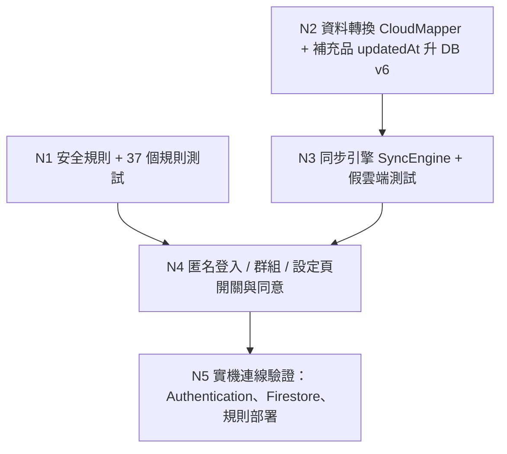

# P7 雲端同步 — 任務拆解（Graph）

> 範圍：匿名登入、Firestore 同步、安全規則和測試。照片／附件上傳、QR 家庭群組是 P8；綁定 Google、刪除帳號、App Check 是 P9。

## 雲端資料結構（一開始就是「群組制」，P8 加家人時不用改）
```
users/{uid}                 { groupId }                       只有本人能讀寫
groups/{gid}                { ownerUid, memberUids[], ... }   只有成員能讀；只有擁有者能改成員
groups/{gid}/pets|records|reminders|supplements/{id}          只有成員能讀寫，欄位有白名單與長度檢查
```
- 每個人第一次開啟同步時，自動建立「自己的私人群組」（成員只有自己）。
- `notifiedFor`（這支手機已經通知過）是裝置專屬狀態，**不上雲**。
- 照片檔名（`photoFile`）會同步，但檔案本身 P8 才上傳，所以其他裝置暫時看不到頭像。

## 同步方式
- 本機優先：畫面永遠讀寫 Room，同步在背景進行，離線照常使用。
- 上傳：找出「有未上傳修改」的資料，批次上傳；上傳不會被中途取消（否則舊版本可能被重送）。
- 順序以**雲端伺服器時間**為準（D55）：每次上傳由伺服器蓋 `serverUpdatedAt`，規則強制等於請求時間。本機用 `sync_meta` 記錄每筆「上次同步的版本」；有未上傳修改的資料不被覆蓋、稍後上傳（後到雲端的贏）。每筆雲端資料套用時，「檢查＋寫入」在同一個資料庫交易內。
- 垃圾桶：刪除是「標記」所以會同步；超過 7 天的雲端副本在啟動時清掉，也不會被其他裝置救回。
- 預設關閉，設定頁開啟時要同意說明（D54）。

## Node 圖


| Node | 內容 | 狀態 |
|---|---|---|
| N1 | `firebase/firestore.rules`＋`firebase/test/rules.test.mjs`（模擬器，`npm test`） | ✅ 37/37 |
| N2 | `CloudMapper`（10 個單元測試）、補充品加 `updatedAt`（資料庫 v6、遷移測試） | ✅ |
| N3 | `SyncEngine`、`FirestoreRemote`、`SyncDao`；9 個引擎測試（含兩台裝置同步、衝突、垃圾桶） | ✅ |
| N4 | `CloudSync`（匿名登入、建立群組、自動重試）、設定頁開關＋同意對話框、隱私說明更新 | ✅ 程式完成 |
| N5 | 對真正的 Firebase 專案驗證 | ⏳ 等使用者在後台開啟 Authentication（匿名）、建立 Firestore、部署規則 |
