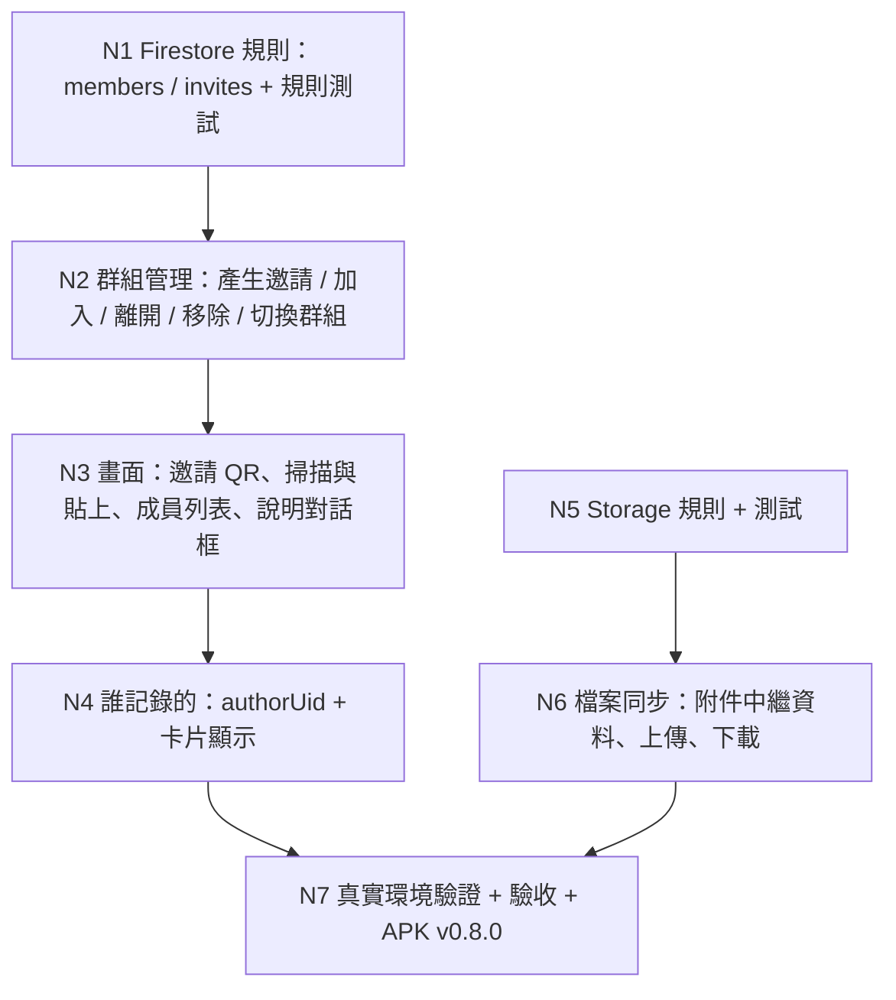

# P8 家庭群組與照片雲端同步 — 任務拆解（Graph）

> 範圍：QR Code 家庭群組（邀請碼有期限、只能用一次）、成員列表／移除／離開、卡片顯示「誰記錄的」、照片與附件上雲。
> 綁定 Google、刪除帳號、App Check 是 P9。**不使用 Cloud Functions**，全部靠安全規則，維持簡單、費用低。

## 家庭群組怎麼運作（只靠安全規則）
```
groups/{gid}                       { ownerUid, memberUids:[owner], ... }          （P7 已有）
groups/{gid}/members/{uid}         { name, role:'member', joinedAt, inviteCode }   加入的家人
groups/{gid}/invites/{code}        { createdAt, expiresAt, used, usedBy? }         邀請（code = 隨機 128 位元）
```
- **成員** = 群組擁有者（`memberUids`）或 `members/{uid}` 存在的人；`isMember()` 兩者都認。
- **邀請**：擁有者產生邀請（預設 24 小時內有效），畫面顯示 QR Code，也顯示連結／文字碼（沒有鏡頭、或掃不到時用貼上的）。
- **加入**：對方掃 QR（Google 掃描元件，不需要相機權限）→ 一個批次同時做兩件事：把邀請標成「已使用」＋建立自己的 `members/{uid}`。規則用 `getAfter` 確認兩件事同時發生，且邀請當下沒過期、沒被用過 → 同一個碼只能用一次，過期無效。
- **移除／離開**：擁有者可刪任何 `members/{uid}`；成員可刪自己。被移除的手機下次同步發現不是成員，就改回自己的私人群組。
- **加入時我的資料呢？** 加入者目前手機上的寵物與紀錄會一起上傳到家庭群組（ID 是 UUID，不會衝突），加入前會跟使用者說明。
- **離開／被移除後**：手機上的資料保留（不自動刪除使用者資料），改成自己的新私人群組重新同步。（D59）

## 誰記錄的
- 紀錄多一個 `authorUid`（空值＝沒開雲端時記的）；成員的暱稱存在 `members/{uid}.name`（擁有者的存在群組文件）。
- 群組有 2 人以上時，紀錄卡片顯示「媽媽 記錄」。

## 照片與附件
- 檔案放 Cloud Storage：`groups/{gid}/files/{檔名}`（檔名是本機已有的隨機檔名，頭像與附件共用）。
- 附件的中繼資料（檔名、類型、大小、顯示名稱）跟著**紀錄文件**一起同步（紀錄文件多一個 `attachments` 陣列），不另開資料表。
- 上傳：同步開啟後，找出本機有、雲端還沒有的檔案上傳；下載：資料裡有引用、本機沒有的檔案下載。
- Storage 規則：只有成員能讀寫；單檔 ≤ 10 MB；只收圖片與 PDF。成員身分用 Firestore 判斷（跨服務規則）。
- 雲端檔案清理（刪除紀錄後的孤兒檔）：這一版先不做，列入 P9 的「刪除帳號與資料」一併處理。

## Node 圖


| Node | 內容 | 狀態 |
|---|---|---|
| N1 | Firestore 規則：`invites` / `members`、`authorUid`、`attachments`；規則測試（67 個，Firestore＋Storage 模擬器） | ✅ 已部署 |
| N2 | `FamilyService`、`CloudSync` 的邀請 / 加入 / 離開 / 移除 / 切換群組；`InviteLink` | ✅ |
| N3 | 「家庭群組」畫面：成員、邀請 QR、分享連結、掃描（Google 掃描元件）、貼上連結、移除、離開、改名 | ✅ |
| N4 | `Record.authorUid`（資料庫 v8）；卡片顯示「誰記錄的」（2 人以上才顯示） | ✅ |
| N5 | `storage.rules`（成員才能讀寫、≤10MB、圖片與 PDF）＋規則測試 | ✅ 已部署（需授予 Storage 服務帳號 `roles/firebaserules.firestoreServiceAgent`） |
| N6 | `FileSync`：頭像與附件上傳 / 下載；附件清單跟著紀錄文件同步 | ✅ |
| N7 | 真實環境驗證（兩個獨立用戶端）＋驗收＋APK v0.8.0 | ✅ |

## 實作上的重點
- 附件與紀錄的寫入順序：先寫附件、最後才寫紀錄（紀錄更新才會被標成「待上傳」），避免只上傳了一半。
- 下載來的檔名會檢查，不允許跳出資料夾（`../`）。
- 即時雲端測試 `FamilyLiveTest`：A（本 App）與 B（第二個 Firebase 用戶端）— 邀請、加入、一次性邀請、讀檔、被移除後鎖出；以及「本機掃別人的邀請加入、再離開」。

